<!-- Header -->


<div align="center">

<a href="https://aekankpatel.com"></a>

<br/>

<a href="https://aekankpatel.com/assets/Aekank_Patel_Resume-DbaqX2yA.pdf"></a>
<a href="https://aekankpatel.com"></a>
<a href="https://linkedin.com/in/aekankpatel"></a>
<a href="https://medium.com/@aekankpatel"></a>
<a href="mailto:aekankpatel@gmail.com"></a>

<br/>


</div>

<br/>

### ⚡ The short version

```python
aekank = {
    "builds":   ["agentic AI systems", "RAG pipelines", "LLM guardrails", "ML products end to end"],
    "studies":  "MS Data Science @ Stevens Institute of Technology",
    "focus":    "LLM systems that are reliable, explainable, and actually deployed",
    "next":     "a team that ships ML to real users",
}
```

<br/>

## 🚀 Things I've Built (click and try them)

<table>
<tr>
<td width="50%" valign="top">

### 🧮 Mathenza
**A math solver that double-checks itself.** Agentic solver with step-by-step solutions, independent verification and error recovery using real computational tools.

`LangGraph` `LangChain` `LLM Reasoning` `Python` `Docker` `CI/CD`

<a href="https://mathenza.vercel.app"></a>
<a href="https://github.com/aekankpatel/Mathenza"></a>

</td>
<td width="50%" valign="top">

### 💰 FinRAG
**Ask a financial report anything.** Plain-English questions over dense financial documents, with answers that cite their sources.

`LlamaIndex` `BGE Embeddings` `Groq` `Streamlit`

<a href="https://huggingface.co/spaces/aekankpatel/finrag"></a>
<a href="https://github.com/aekankpatel/finrag"></a>

</td>
</tr>
<tr>
<td width="50%" valign="top">

### 📊 Queryra
**An AI data analyst that checks its own work.** Agentic analytics platform that writes and runs SQL on its own, runs statistical analysis, verifies its evidence, and produces charts and reports.

`LangGraph` `LangChain` `MCP` `LLMs` `SQL` `Docker` `CI/CD`

<a href="https://queryra.vercel.app"></a>
<a href="https://github.com/aekankpatel/queryra"></a>

</td>
<td width="50%" valign="top">

### 🕵️ FraudGen
**Fraud detection that explains itself.** XGBoost, rule-based checks and a local LLM classify transactions and say *why* each one was flagged.

`XGBoost` `Ollama` `Flask` `React` `PaySim`

<a href="https://fraud-gen.vercel.app"></a>
<a href="https://github.com/aekankpatel/Fraud_Gen"></a>

</td>
</tr>
<tr>
<td width="50%" valign="top">

### 🛡️ NLIP Sentinel
**A bodyguard for AI agents.** Sits inside AG2 multi-agent workflows, checks every message, blocks unsafe tool calls, enforces role permissions, asks for human approval on risky actions, and logs everything.

`AG2` `FastAPI` `React` `Vite`

<a href="https://nlip-sentinel.vercel.app"></a>
<a href="https://github.com/aekankpatel/nlip-sentinel"></a>

</td>
<td width="50%" valign="top">

### 🔬 InsightForge AI
**Instant data exploration.** Upload a dataset and get profiling, anomaly detection, correlation analysis and AI-written insights in seconds.

`pandas` `Plotly` `Streamlit` `Groq`

<a href="https://huggingface.co/spaces/aekankpatel/insightforgeai"></a>
<a href="https://github.com/aekankpatel/insightforgeai"></a>

</td>
</tr>
<tr>
<td width="50%" valign="top">

### 📝 ResumeAI
**Resumes tailored to every job.** Builds one-page, ATS-friendly resumes matched to a job description, then lets you edit, save and download them as polished PDFs.

`Next.js` `Prisma` `Groq` `Tailwind` `XeLaTeX`

<a href="https://github.com/aekankpatel/resumeai"></a>

</td>
<td width="50%" valign="middle" align="center">

### 🧭 Want to see more?
Deep learning, reinforcement learning, A/B testing, healthcare analytics and more.

<a href="https://github.com/aekankpatel?tab=repositories"></a>

</td>
</tr>
</table>

<br/>

## 🛠️ My Toolbox

<table>
<tr><td><b>🤖 AI / LLM</b></td><td>


</td></tr>
<tr><td><b>🧠 ML / Deep Learning</b></td><td>


</td></tr>
<tr><td><b>📊 Data & Analytics</b></td><td>


</td></tr>
<tr><td><b>⚙️ Apps & APIs</b></td><td>


</td></tr>
<tr><td><b>☁️ Cloud & Tools</b></td><td>


</td></tr>
</table>

<br/>

## 📈 GitHub Pulse

<div align="center">





</div>

<br/>

<div align="center">

### 💬 Hiring for Data Science or ML? Let's talk.

<a href="mailto:aekankpatel@gmail.com"></a>
<a href="https://aekankpatel.com/assets/Aekank_Patel_Resume-DbaqX2yA.pdf"></a>

</div>


